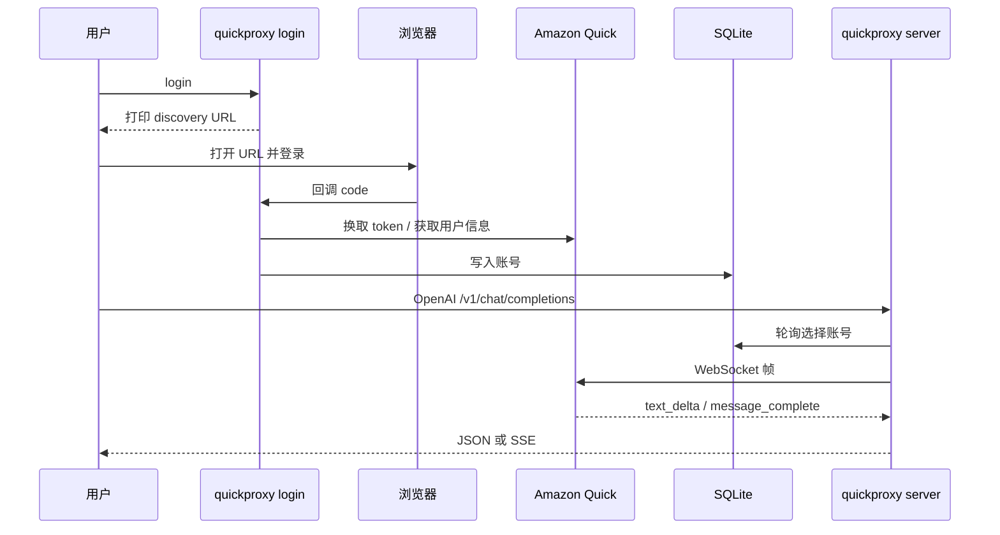

# QuickWork / Amazon Quick → OpenAI API

把 Amazon Quick（QuickWork）桌面端的聊天能力转换成 **OpenAI 兼容的 HTTP API**。

项目是单一 Go 可执行文件：原生 OAuth 登录、账号存储、token 刷新和反代全部由 Go 完成，不需要 Python，也不用启动官方桌面应用或 outpost 进程。登录后由反代把 `/v1/chat/completions` 请求转换为 QuickWork WebSocket 帧，并把结果转回普通 JSON 或 SSE。

> 非官方项目，与 Amazon / AWS 无关联。请仅在你拥有或获得明确授权的账号上使用，并遵守相关服务条款。

## 功能

- `POST /v1/chat/completions`，支持流式（SSE）与非流式响应
- `GET /v1/models`，返回本地模型别名
- 原生 social 登录（AWS IAM Identity Center OIDC）与企业 OIDC 登录，使用 PKCE
- 支持服务器/远程登录：手动粘贴浏览器 callback URL，无需开放本地回调端口
- 服务端配置集中存放在 `config.json`
- 账号存放在 SQLite（`data/quickwork.db`），支持多账号轮询与自动刷新
- 请求按轮询选择账号；到期 token 自动 refresh；失败时切换到下一个账号重试
- 可选本地 API key 保护
- 默认复用上游会话（`session_reuse=true`）；设为 `false` 时每轮结束删除会话，避免污染聊天列表
- 会话复用：同一段对话固定上游 thread 与账号，每轮只送新增消息，避免重送整份 transcript 撞 64 KB 上限；可用 `X-Conversation-Id` / `X-Thread-Id` 显式指定会话
- 客户端 `tools` / `functions` 通过 `<caller_tool_interface>` 文本协议桥接；代理解析 `<client_tool_call>` 并返回 OpenAI `tool_calls`，实际执行仍在客户端
- 工具桥接兼容多种模型写法：`arguments` / `parameters` / `input` / `args`、`tool_calls` / `tool_call` / `function_call`、Markdown 代码块、`functions.` 等命名空间前缀、大小写与唯一后缀匹配；支持同一轮并行多个工具调用
- 历史中的 `assistant.tool_calls` / `role: tool` 仍会按文本渲染，供上游理解已有上下文
- 使用上游 `turn_usage` 返回 `usage` 与 `prompt_tokens_details.cached_tokens`
- `system` / `developer` 消息与工具定义放在本轮 user 文本开头的 `[System instructions from the API caller]` 区块内；上游会忽略每轮 `system_prompt` 字段，并把 `custom_prompt` 当作低信任的个人偏好，user 轮次是唯一可靠送达调用方指令的通道
- 64 KB 单帧预算按实际 JSON 字节计算：用户内容过大时优先走 out-of-band 附件（`upload-attachment` → DLP 扫描 → `files/upload`），WebSocket 只发送短引用与 `attachments` 元数据；附件只包含用户内容，调用方指令仍留在 WS 文本里。附件不可用时才裁剪、保留开头与结尾，避免直接返回 `request_too_large`
- `chat_agent_id` 可指定一个 QuickWork 自定义 agent，以替代默认内置 agent 的提示词与工具策略
- `/admin` 密码保护的管理前端，与 `/v1` 共用端口和进程：账号列表 / 刷新 / 删除、网页内完成 OAuth 登录（手动回填或本机回调）、配置编辑、请求日志与 Playground
- 一条 `docker compose up -d` 即可部署：镜像由 GitHub Actions 构建并推送到 GHCR，`.env` 定义端口、管理密码与 API key

## 环境要求

- Go 1.26+（仅构建时需要）
- 一个可正常登录的 Amazon Quick 账号
- 浏览器与 `quickproxy login` 运行在**同一台机器**，且本机回调端口（默认 `18080`）可被浏览器访问

## 快速开始

### 1. 构建

```bash
cd quickwork-openai
go build -o bin/quickproxy.exe ./cmd/quickproxy   # Windows
# go build -o bin/quickproxy ./cmd/quickproxy     # macOS / Linux
```

### 2. 登录上游账号

```bash
./bin/quickproxy login --provider social
```

首次运行会在当前目录创建 `config.json`，并在 `data/quickwork.db` 初始化 SQLite。终端会打印一个 discovery URL，例如：

```
https://quick.aws.com/sn?qwSurface=desktop:<nonce>:18080:1.2.4660
```

在**同一台机器**的浏览器中打开它，完成登录。工具会接收浏览器回调、完成 OAuth / PKCE、交换 token、获取用户信息，并把账号写入 SQLite。完成后终端只打印账号显示信息、`ws_host` 和到期时间，不打印 token。

企业 SSO 登录：

```bash
./bin/quickproxy login --provider enterprise --region us-east-1
```

需要登录多个账号时，重复执行 `login` 即可。相同 email + tenant 的账号会更新，不会重复插入。

#### 服务器 / 远程登录（手动回填 callback URL）

如果 `quickproxy` 跑在服务器上，浏览器访问不到服务器的 `localhost:18080`，使用手动模式：

```bash
./bin/quickproxy login -manual
```

流程：

1. 终端打印 discovery URL，在任意机器用浏览器打开并登录。
2. 浏览器会跳转到 `http://localhost:18080/callback?...`。这个页面可能打不开，属正常现象；从地址栏复制**完整 URL**，粘贴回终端。
3. 终端会打印 authorize URL；继续在浏览器打开并完成登录。
4. 浏览器会跳转到 `http://127.0.0.1:18080/?code=...`；同样复制地址栏的完整 URL，粘贴回终端。
5. 工具完成 token 交换并写入 SQLite。

工具会根据 URL 参数自动判断阶段：`nonce=...` 是 discovery callback，`code=...&state=...` 是授权完成 callback。贴入 authorize URL、discovery URL、重复的 discovery callback 或带 fragment 的 callback 都会被识别并提示下一步，不会重复注册 OAuth client。

整个过程不需要服务器开放回调端口；回调端口只用于生成浏览器地址。也可以把 callback URL 通过 stdin 管道传入，便于脚本化。

### 3. 启动反代

```bash
./bin/quickproxy server
```

服务读取当前目录的 `config.json`。默认监听 `127.0.0.1:8080`。如果 `api_keys` 为空，代理关闭 API key 鉴权，适合纯本机使用。

### 4. 调用

```bash
curl http://127.0.0.1:8080/v1/models \
  -H "Authorization: Bearer local"
```

```bash
curl http://127.0.0.1:8080/v1/chat/completions \
  -H "Authorization: Bearer local" \
  -H "Content-Type: application/json" \
  -d '{
    "model": "smart",
    "stream": true,
    "messages": [{"role": "user", "content": "用三句话解释 QUIC"}]
  }'
```

Python SDK：

```python
from openai import OpenAI

# api_keys 为空时 api_key 可填任意值；配置后填对应 key。
client = OpenAI(base_url="http://127.0.0.1:8080/v1", api_key="local")

for chunk in client.chat.completions.create(
    model="smart",
    messages=[{"role": "user", "content": "hello"}],
    stream=True,
):
    print(chunk.choices[0].delta.content or "", end="")
```

## 配置 `config.json`

`quickproxy server` / `login` 在文件不存在时会写入默认配置。完整示例：

```json
{
  "addr": "127.0.0.1:8080",
  "database": "data/quickwork.db",
  "api_keys": [],
  "models": ["smart", "fast", "balanced", "auto"],
  "default_model": "smart",
  "request_timeout": "5m",
  "refresh_before": "10m",
  "max_attempts": 3,
  "app_version": "1.2.4660",
  "surface": "QUICK_WORK_DESKTOP_WINDOWS",
  "outpost_id": "",
  "working_session_id": "",
  "timezone": "UTC",
  "locale": "en-US",
  "thinking_effort": "",
  "chat_agent_id": "",
  "keep_sessions": false,
  "session_reuse": true,
  "session_ttl": "30m",
  "oauth": {
    "provider": "social",
    "build_stage": "prod",
    "region": "",
    "callback_port": 18080,
    "timeout": "1h"
  }
}
```

| 字段 | 默认 | 说明 |
|---|---|---|
| `addr` | `127.0.0.1:8080` | HTTP 监听地址 |
| `database` | `data/quickwork.db` | SQLite 文件；相对路径基于 `config.json` 所在目录 |
| `api_keys` | `[]` | 允许的本地 API key；为空时关闭鉴权 |
| `models` | `smart,fast,balanced,auto` | `/v1/models` 返回值与 model 白名单 |
| `default_model` | `smart` | 未知 model 的映射 |
| `request_timeout` | `5m` | 单次上游请求超时 |
| `refresh_before` | `10m` | token 距离到期小于该值时自动 refresh |
| `max_attempts` | `3` | 单次请求最多尝试的账号数 |
| `app_version` | `1.2.4660` | 上游握手使用的 appVersion |
| `surface` | `QUICK_WORK_DESKTOP_WINDOWS` | 上游握手使用的 surfaceType |
| `outpost_id` / `working_session_id` | 空 | 上游握手可选字段 |
| `timezone` / `locale` | `UTC` / `en-US` | `user_message` 中的时区与语言 |
| `thinking_effort` | 空 | `off`、`low`、`medium`、`high`；空=服务端默认，`off` 会显式发送关闭 |
| `chat_agent_id` | 空 | 指定 QuickWork 自定义 agent；服务端按该 agent 的 system prompt 与 tool policy 执行，用于隔离默认内置提示词和内置工具 |
| `keep_sessions` | `false` | 关闭 `session_reuse` 时，是否保留上游会话 |
| `session_reuse` | `true` | 以固定上游会话只送新增消息；同一会话固定使用原账号 |
| `session_ttl` | `30m` | 会话闲置多久后从代理内存移除 |
| `oauth.provider` | `social` | `login` 默认 provider |
| `oauth.build_stage` | `prod` | `prod`、`beta`、`integ`、`dev` |
| `oauth.region` | 空 | 企业 discovery 的 region 前缀；social 使用 discovery 返回的 IDC region |
| `oauth.callback_port` | `18080` | 本机 OAuth 回调端口 |
| `oauth.timeout` | `1h` | 等待浏览器完成登录的超时 |
| `webui.enabled` | `true` | 是否提供 `/admin` 管理前端 |
| `webui.password` | 空 | 管理密码（明文）；为空且没有 `password_hash` 时管理前端返回 503 |
| `webui.password_hash` | 空 | pbkdf2-sha256 哈希，优先于 `webui.password`；由 `quickproxy passwd` 写入 |
| `webui.session_ttl` | `12h` | 管理登录会话有效期 |
| `webui.max_attempts` | `10` | 同一 IP 每 5 分钟允许的登录失败次数，超出返回 429 |
| `webui.trust_proxy` | `false` | 是否采信 `X-Forwarded-For` 作为登录限速的客户端 IP |

时间字段接受 Go duration 字符串（`30s`、`5m`、`1h`）。

需要 API key 时，把 key 写进 `api_keys`：

```json
{
  "api_keys": ["sk-local"]
}
```

之后请求需带 `Authorization: Bearer sk-local`（或 `X-Api-Key: sk-local`）。

## 命令

| 命令 | 说明 |
|---|---|
| `quickproxy server` | 启动反代 |
| `quickproxy login` | 浏览器 OAuth 登录并写入 SQLite |
| `quickproxy accounts` | 列出账号、到期时间、使用次数与最近错误 |
| `quickproxy refresh` | 刷新全部账号的 token |
| `quickproxy refresh -account ID` | 只刷新一个账号 |
| `quickproxy logout -all` | 删除全部账号 |
| `quickproxy logout -account ID` | 删除一个账号 |
| `quickproxy passwd` | 设置管理密码，写入 `webui.password_hash` 并清空明文 |
| `quickproxy config -from-env` | 把环境变量合并进 `config.json`（容器 entrypoint 启动前调用） |

所有命令都支持 `-config PATH`，默认 `config.json`。

从旧版升级：旧的 `auth/quickauth.py` 已移除，`data/session.json` / `data/upstream.json` 不再读取。请重新执行一次 `quickproxy login`；之后所有账号都由 SQLite 管理。

`login` 常用参数：

| 参数 | 默认 | 说明 |
|---|---|---|
| `-provider` | `config.oauth.provider` | `social`、`enterprise`、`gateway`、`social_gateway` |
| `-stage` | `config.oauth.build_stage` | `prod`、`beta`、`integ`、`dev` |
| `-region` | `config.oauth.region` | 企业 discovery 的 region 前缀；social 使用 discovery 返回的 IDC region |
| `-port` | `config.oauth.callback_port` | 本机回调端口 |
| `-timeout` | `config.oauth.timeout` | 等待浏览器完成登录的超时 |
| `-open` | 关闭 | 同时用默认浏览器打开 URL |
| `-manual` | 关闭 | 不监听本地回调端口，手动粘贴浏览器地址栏中的 callback URL（适合服务器） |

## 管理前端 `/admin`

管理前端和 OpenAI 接口**共用同一个端口、同一个进程**：`/v1` 走 API，`/admin` 走界面，静态资源编译进二进制，没有 npm 构建步骤，也没有额外监听端口。

```bash
# 1. 设置管理密码（写入 config.json 的 webui.password_hash）
./bin/quickproxy passwd -password '你的密码'

# 2. 启动服务
./bin/quickproxy server
# log: management interface on: http://127.0.0.1:8080/admin/
```

也可以直接在 `config.json` 里写明文密码，适合先跑起来：

```json
{
  "webui": {
    "enabled": true,
    "password": "改成你的密码",
    "session_ttl": "12h",
    "max_attempts": 10,
    "trust_proxy": false
  }
}
```

页面能力：

| 页面 | 功能 |
|---|---|
| 总览 | 监听地址、运行时长、账号健康、最近请求统计、token 合计、接入信息（一键复制 curl / Python / Base URL）、生效配置 |
| 账号 | 账号列表（provider、区域、到期倒计时、使用次数、`last_error`）、单个/全部刷新 token、删除账号 |
| 登录上游 | 在网页里完成 OAuth：手动模式粘贴浏览器 callback URL，本机模式直接走 `127.0.0.1:18080` 回调；实时输出流程日志与可点击的授权链接 |
| 配置 | 编辑 `config.json` 的主要字段；`webui` 段落保存后立即生效，其余字段在下次启动生效并在页面上标注 |
| 请求日志 | 最近 500 条聊天请求的状态、模型、账号、耗时、token、`finish_reason` 与错误 |
| Playground | 直接走完整上游链路测试对话，支持流式；用管理会话鉴权，不需要本地 API key |

鉴权与安全：

- 登录只校验一个密码，成功后在 `Path=/admin` 下发 `HttpOnly` + `SameSite=Strict`（HTTPS 下附带 `Secure`）的会话 cookie；会话表按 cookie 的 SHA-256 索引，密码一变立刻失效。
- 所有写操作要求 `X-CSRF-Token`，并校验 `Origin` 与 `Host` 一致，避免跨站表单和跨站 fetch。
- 登录失败按客户端 IP 做 5 分钟窗口限速（`webui.max_attempts`），同时最多 4 个 PBKDF2 计算并发，防止把管理密码当靶子。
- 没有配置密码时，`/admin` 下所有路径返回 503 并提示怎么设置；`/v1` 完全不受影响。
- 管理端点带 `Content-Security-Policy: default-src 'self'`、`X-Frame-Options: DENY`、`X-Content-Type-Options: nosniff`，且不返回 CORS 头，避免被第三方页面驱动。
- `webui.trust_proxy` 默认关闭。挂在反向代理后面又需要按真实客户端 IP 限速时，才打开它并确保代理会覆盖 `X-Forwarded-For`。

管理 API（全部在 `/admin/api` 下）：`POST /auth/login`、`GET /auth/session`、`POST /auth/logout`、`GET /overview`、`GET /endpoints`、`GET /accounts`、`POST /accounts/refresh`、`DELETE /accounts/{id}`、`POST /accounts/login`、`GET /accounts/login/{id}`、`POST /accounts/login/{id}/callback`、`DELETE /accounts/login/{id}`、`GET /config`、`PUT /config`、`GET /logs`、`POST /playground`。

## Docker 部署

仓库自带镜像构建、Compose 和 CI，默认使用 Actions 推到 GHCR 的预构建镜像：

```bash
cp .env.example .env        # 至少改 WEBUI_PASSWORD、API_KEYS
docker compose pull
docker compose up -d
# 打开 http://127.0.0.1:<WEB_PORT>/admin/
```

| 文件 | 作用 |
|---|---|
| `Dockerfile` | 多阶段构建，最终 `alpine` 镜像以 uid 10001 非 root 运行 |
| `docker/entrypoint.sh` | 启动前 `quickproxy config -from-env`，把环境变量渲染进 `config.json` |
| `docker-compose.yml` | 默认 `image: ghcr.io/qingdeng888/aws-quickwork-2api:latest`，挂载 `./data`，带 healthcheck |
| `docker-compose.build.yml` | 叠加使用即改为本地构建：`docker compose -f docker-compose.yml -f docker-compose.build.yml up -d --build` |
| `.env.example` | 端口、管理密码、API key、OAuth 与模型等变量模板 |
| `.github/workflows/docker.yml` | push `main` / 打 `v*` tag 构建 amd64+arm64 推到 GHCR，并对 amd64 镜像做冒烟测试 |

- 所有持久化数据都在 `./data`：`config.json` + `quickwork.db`。入口脚本会以 root 修正该目录属主后立刻降权到 uid 10001，正常部署不需要手动 `chown`；只有显式配置了 `user:` 时才需要预先授权。
- `.env` 的变量每次启动都会合并进 `config.json`（空值不覆盖）；`CONFIG_FROM_ENV=false` 可关闭。密码想以 `/admin` 修改为准，就把 `WEBUI_PASSWORD` 留空或改用 `WEBUI_PASSWORD_HASH`。
- 宿主机浏览器无法回调容器里的 `127.0.0.1:18080`，容器内请在 `/admin` → 登录上游 用「手动回填 callback URL」，或执行 `docker compose run --rm -it quickproxy login -manual`。
- 环境变量与配置字段的完整对照见 [DEPLOY.md](DEPLOY.md#6-常驻运行)。

## 多账号轮询

账号存在 SQLite 的 `accounts` 表，按 ID 轮询：

1. 每个请求选择下一个启用账号。
2. 如果 token 在 `refresh_before` 内到期，先用 refresh token 自动刷新。
3. 刷新失败或账号不可用时记录 `last_error`，跳过该账号继续轮询。
4. 单次请求最多尝试 `max_attempts` 个账号；非流式请求和尚未向客户端发送任何数据的流式请求会自动换号重试。
5. 一旦流式响应已经开始，就不会中途换号，避免客户端收到重复内容。

除请求触发的刷新外，服务还会在后台做定期检查：每 `refresh_before / 2`（上限 1 分钟、下限 15 秒）扫一遍账号，把进入刷新窗口的账号提前换掉 token，因此**即使没有流量、甚至只打开管理页面看倒计时，账号也会在到期前自动刷新**。刷新失败的账号会记录 `last_error` 并在 15 分钟后重试；同一账号同一时刻只会有一个刷新在跑（请求与后台共用账号锁）。

`quickproxy accounts` 可查看每个账号的状态；`quickproxy refresh` 会刷新全部账号。上游 refresh token 失效时，对应账号需要重新执行 `quickproxy login`。

## 工作方式



- 登录完全在 `quickproxy login` 内完成，不依赖官方桌面应用或 outpost。
- `quickproxy server` 从 SQLite 读取 `jwt`、`ws_host` 和 `provider`，连接上游 WebSocket。
- 上游不是 OpenAI HTTP API，而是 WebSocket JSON 帧；`internal/proxy/wire.go` 负责帧编码与 event-stream 解码。

### 提示词与工具调用

- `system` / `developer` 消息会按原顺序合并，与工具定义一起组成 caller 指令块，放在本轮 user 文本开头：`[System instructions from the API caller]` … `[End system instructions]`，后面才是 `[User message]` 与 transcript。
- 这是为了适配上游实际行为：`user_message.payload.system_prompt` 会被服务端忽略（模型完全看不到），`custom_prompt` 会被当成低信任的个人偏好、可能被拒绝执行。放进 user 轮次的调用方指令则会被当作本轮任务，实测能稳定驱动工具调用与格式要求。
- caller 指令块后面固定追加一条简短的中性 relay 说明：本轮通过 OpenAI 兼容 API 转发，调用方指令与 `<caller_tool_interface>` 定义本轮任务和工具，工具由调用方执行。刻意的「丢弃服务端提示词 / 忽略身份」措辞会触发上游的安全判断，使模型连正常指令一起拒绝，因此不使用。
- 客户端 `tools` / `functions` / `tool_choice` 会原样写入 caller 指令块中的 `<caller_tool_interface>`，并明确说明这些工具由调用方提供、执行并回传结果，模型不需要内置对应的工具。
- 模型使用 `<client_tool_call>{"name":"...","arguments":{...}}</client_tool_call>` 发起调用。解析器同时兼容 `<tool_call>`、`<function_call>`、整段 JSON、Markdown 代码块、`tool_calls` / `tool_call` / `function_call` 包装、`arguments` / `parameters` / `input` / `args` 字段、`functions.` 等前缀、大小写差异和唯一后缀匹配。未知工具名或非法 JSON 会保留为普通文本。
- 并行调用：允许在同一回复中连续输出多个 `<client_tool_call>`；`parallel_tool_calls=false` 时只保留第一个。
- 代理把解析结果转成 OpenAI `tool_calls`，但**不执行工具**；客户端执行后把结果作为 `role: tool` 发回，代理再转成文本上下文。
- 上游原生 `tool_start` / `tool_arguments` / `tool_progress` / `tool_call` / `tool_complete` / `message_complete.tool_calls` 也会被收集；`tool_progress.input_delta` 会累积为完整参数。如果文本标记没有解析出调用，代理会按客户端声明的工具名把原生事件回退成 `tool_calls`。
- 上游一个 WebSocket 帧内可能包含多条 event-stream 消息；解码器会按顺序全部处理，不会只取第一条。
- 上游只输出 thinking、空白或零宽字符时，代理返回明确错误并带上 `completion_tokens`，不再返回空的 `finish_reason=stop`。
- 有客户端工具时，流式响应会缓冲到本轮结束，再一次性发送文本或 `tool_calls`；非流式不受影响。
- `tool_choice: "none"` 关闭桥接；指定函数时只接受该函数；`parallel_tool_calls=false` 时最多返回一个工具调用。
- 内置 agent 的 60K+ token 提示词、产品身份与内置工具仍由 QuickWork 服务端维护，无法通过 `user_message` 删除；调用方指令决定任务行为，但模型仍可能自称 AWS Quick。若需要彻底替换提示词与工具策略，在 `config.json` 设置 `chat_agent_id` 指向一个关闭内置工具、使用自定义 system prompt 的 QuickWork agent；代理会把该 ID 放进 `user_message.chat_agent_id`。

### 会话复用

- 首轮发送完整 transcript，并记录上游 `thread_id` 与账号。
- 后续请求若消息历史是上次已发送历史的前缀，只发送新增后缀；这样 64 KB 预算主要留给新消息。
- 会话键优先使用 `X-Conversation-Id`，其次 `X-Thread-Id`；都没有时使用完整 system prompt（含工具定义）加第一条非 system 消息的哈希。不同工具的请求不会复用同一个上游 thread。
- system prompt 或工具定义变化、历史被编辑、或没有新增消息时，自动回退为完整 transcript + 新上游会话。
- 同一会话固定使用原账号；账号不可用或复用失败时，自动换账号并以完整 transcript 新建会话。
- 会话状态只保存在内存，进程重启后首轮回退完整 transcript。闲置超过 `session_ttl` 会从代理移除。
- 复用启用时不会发送 `session_delete`，上游会话会保留到服务端自身过期。

### 请求日志

每个聊天请求输出请求开始、每次账号尝试、最终结果，以及一行上游事件统计。最终结果包含状态、账号、上游模型、尝试次数、耗时、token 用量、`finish_reason`、工具调用数和错误信息。

```
chat chatcmpl-... start model=smart upstream_model=smart stream=false messages=2 prompt_chars=205 system_chars=40587 thread=""
chat chatcmpl-... attempt=1/3 account=1:social:user@example.com
upstream events thread=... counts=map[text_delta:2 text_complete:1 turn_usage:1] text_chars=89 tool_calls=0
chat chatcmpl-... done status=ok account=1:social:user@example.com model=smart attempts=1 elapsed=1.234s tokens{prompt=1200 completion=56 total=1256 cache_read=1024 cache_write=0} finish=stop tool_calls=0
```

`status` 为 `ok`、`empty` 或 `failed`；`attempt` 为 `id/最大尝试次数`。失败时附加 `error=...`。日志不会输出 token、client secret 或请求正文。

## 安全与隐私

- `data/quickwork.db` 包含 access token、refresh token、client secret 和用户信息，已被 `.gitignore` 排除。
- 当单个 `user_message` 超过 64 KB 且账号有 `tenant_url` 时，代理会把该轮用户内容作为临时文本附件上传到 Quick 的附件服务并等待 DLP 扫描；这是绕过单帧上限的方式，内容仍位于你的 Quick 租户内，但受组织 DLP 策略约束。
- `config.json` 默认不含密钥；如果写入 `api_keys`，不要提交真实 key。
- 登录密码只在 Amazon 的浏览器页面中输入，本项目不会保存密码。
- 管理密码保存在 `config.json`：用 `quickproxy passwd` 写入的是 PBKDF2-SHA256 哈希；直接写 `webui.password` 则是明文，记得给文件设 `600`。管理会话只存在内存，重启即失效。
- 反代默认只监听 `127.0.0.1`。不要把端口直接暴露到公网；如确需远程访问，请自行加 TLS 与访问控制。
- `quickproxy logout -all` 会删除本地账号与 refresh 状态。
- 不要提交或分享 `data/` 目录。

## 限制

- 只实现聊天补全。`temperature`、`max_tokens`、`stop`、`response_format` 等采样参数不会传给上游；`n > 1` 会返回 400。
- 上游 `user_message` 帧上限 64 KB。会话复用开启时通常只送新增消息；若单个 delta 仍超限，代理会先把该轮用户内容上传为上游附件（`POST /integration/quick-work/upload-attachment`、轮询 `attachment-dlp-status`、再以 `qbs-event` 投递到 `files/upload/<thread>`），WS 只送短引用和 `attachments` 元数据；附件必须在 DLP 返回 `ALLOW` 后才能使用，`WARN` 视为不可用。附件只放用户内容，调用方指令与工具定义留在 WS 文本中，避免模型把附件里的指令当成注入。附件路径失败、账号没有 `tenant_url`、gateway transport 或被 DLP 拒绝时，代理回退到裁剪：按实际 JSON 字节保留开头与结尾、裁剪中间内容，并记录 `user_message trimmed ...`；只有连最小帧都无法放入时才返回 `400 request_too_large`。
- WebSocket 分片只影响传输层，上游重組後仍按單一 `user_message` 檢查 64 KB。多個 `user_message` 會被視為多輪；`mid_turn` 是 steering，`message_split` 是服務端輸出事件，不能用來拼接同一輪輸入。
- 工具桥接使用文本协议，模型偶尔可能不遵守；有工具时流式响应会缓冲到本轮结束。代理只解析并返回 `tool_calls`，不执行工具。
- 默认内置 agent 仍会在服务端附加约 60K token 的提示词和内置工具。调用方指令通过 user 轮次影响任务行为，但不能删除服务端上下文或改掉产品身份；需要彻底隔离时使用 `chat_agent_id` 指向自定义 agent。
- 上游会忽略 `user_message.payload.system_prompt`，并把 `custom_prompt` 视为低信任偏好；代理因此不再使用这两个字段。caller 指令跟随 user 文本发送，已在 social 路径用真实账号验证；enterprise / gateway 仍待验证。
- `model` 会映射为上游 agent mode：`smart`、`fast`、`balanced`、`auto`。
- 上游没有模型列表 API；`/v1/models` 返回的是本项目配置的别名。
- social / enterprise 路径已做真实账号验证；`gateway` / `social_gateway` 的 CBOR 路径仍属实验性。
- 上游 access token 通常约 1 小时到期，反代会按 `refresh_before` 自动刷新；也可手动执行 `quickproxy refresh`。refresh 响应未返回新的 ID token 时会保留旧值，用户信息接口短暂失败不会丢弃已刷新的 token。
- 多账号轮询按请求选择账号，不按 token 用量或配额调度。
- 上游接口可能随官方客户端更新而变化；若登录或聊天失败，先重新执行 `quickproxy login`。
- 本项目与 Amazon / AWS 无关联，不提供任何服务保证。

## 故障排查

| 现象 | 处理 |
|---|---|
| `cannot listen on 127.0.0.1:18080` | 关闭占用 18080 的其他进程，或用 `-port` / `oauth.callback_port` 换端口 |
| 浏览器登录后一直等待 | 确认浏览器与命令在同一台机器，且回调端口可达；远程服务器请用 `login -manual` |
| 服务器上 `localhost:18080` 回调打不开 | 这是预期现象；用 `login -manual`，复制浏览器地址栏的完整 URL 回填 |
| `upstream_session_unavailable` / `no accounts configured` | 运行 `quickproxy login` |
| `401 invalid_api_key` | 检查 `config.json` 的 `api_keys` 与请求头中的 key 是否一致 |
| 登录页面报错 | 查看终端输出的错误；确认 `-provider` 与账号类型匹配 |
| 多账号请求总是失败 | 运行 `quickproxy accounts` 查看 `last_error`；对失效账号重新 `login` 或 `logout -account ID` |
| token 过期 | 通常自动刷新；也可运行 `quickproxy refresh` |
| `/admin` 返回 503 `admin_disabled` | 还没设置管理密码：`quickproxy passwd -password '...'` 或写 `webui.password`，然后重启 |
| `/admin` 登录一直提示密码错误 | 确认改的是当前 `-config` 指向的那份 `config.json`；`webui.password_hash` 存在时会忽略 `webui.password` |
| `/admin` 提示 429 | 5 分钟内失败次数超过 `webui.max_attempts`；等待窗口过期，或调大该值 |
| 网页里点「开始登录」后本机模式一直等待 | 浏览器必须能访问服务器的 `127.0.0.1:<callback_port>`；远程用「手动回填」模式 |
| 配置页保存后提示「等待重启」 | `webui` 之外的字段只在下次启动生效，重启 `quickproxy server` 即可 |
| `docker compose up` 报 `env file .env not found` | 先 `cp .env.example .env`，compose 默认从这个文件读取变量 |
| `docker compose pull` 报 `unauthorized` / `denied` | GHCR 包默认私有：在 GitHub 的 package 设置里改成 public，或先 `docker login ghcr.io` |
| 容器起来了但 `/admin` 返回 503 | `.env` 里 `WEBUI_PASSWORD` 为空；填一个至少 8 位的密码后 `docker compose up -d` |
| Linux 上容器报 `permission denied` 写 `/app/data` | 镜像会自动修正属主；如果你在 compose 里写了 `user:`，改为预先 `sudo chown -R 10001:10001 ./data` 或去掉 `user:` |

## 目录

```
quickwork-openai/
  config.json              服务端配置（首次运行自动生成）
  cmd/quickproxy/          CLI：server / login / accounts / refresh / logout / passwd / config
  internal/config/         config.json 加载与默认值、环境变量合并、管理密码哈希
  internal/oauth/          原生 OAuth、PKCE、token refresh、user info
  internal/store/          SQLite 账号存储
  internal/accounts/       多账号轮询与自动刷新
  internal/proxy/          WebSocket codec、OpenAI handler、请求记录
  internal/admin/          /admin 管理 API：会话、CSRF、限速、登录流、配置、日志
  webui/                   管理前端（index.html / app.js / styles.css，go:embed）
  Dockerfile               多阶段镜像构建（非 root 运行）
  docker/entrypoint.sh     容器启动：env → config.json → server
  docker-compose.yml       预构建镜像部署（GHCR）
  docker-compose.build.yml 本地构建覆盖层
  .env.example             部署变量模板
  .github/workflows/       release.yml（二进制）+ docker.yml（镜像）
  data/quickwork.db        运行期账号库（gitignored）
```

## License

本项目采用 [GNU General Public License v3.0](LICENSE) 授权。

## Acknowledgements

Thanks to the [LINUX DO](https://linux.do) community for its support.
